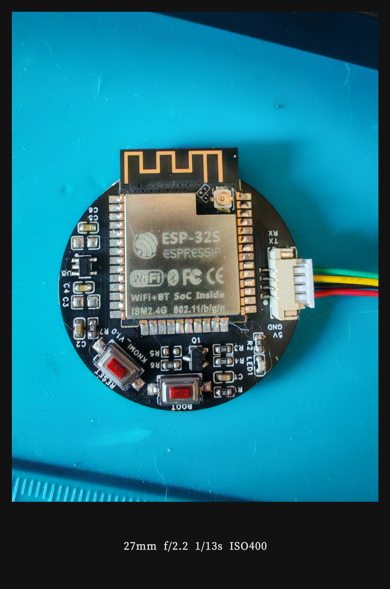

# KNOMI V1 — DiverOfDark 固件移植

基于 [DiverOfDark/KNOMI](https://github.com/DiverOfDark/KNOMI) 分支，适配 **4MB Flash / 无 PSRAM** 的 ESP32-D0WDQ6-V3 硬件。

---

## 硬件信息

| 项目 | 详情 |
|---|---|
| 芯片 | ESP32-D0WDQ6-V3（双核，revision 3.1） |
| Flash | **4MB**（⚠️ 无 PSRAM） |
| 屏幕 | GC9A01 240×240 圆形 SPI |
| 模块 | 乐鑫 ESP32-S 1.28" 圆屏 |

### PCB



> 数据手册：[ESP32-D0WDQ6-V3数据手册.pdf](ESP32-D0WDQ6-V3数据手册.pdf)

---

## 引脚（KNOMI V1）

```
GC9A01_MOSI : GPIO23       GC9A01_DC  : GPIO19
GC9A01_SCLK : GPIO18       GC9A01_RST : GPIO4
GC9A01_CS   : GPIO5        LCD_BL     : GPIO2        BOOT : GPIO0
```

---

## 目录结构

```
.
├── README.md
├── pcb_image.jpg                         # PCB 实物图
├── ESP32-D0WDQ6-V3数据手册.pdf
│
├── firmware/DiverOfDark_KNOMI/           # ✅ 当前固件源码
│   ├── platformio.ini                    #   含 knomiv1-4mb 环境
│   ├── boards/esp32r8_4mb.json           #   4MB Flash 板子定义
│   ├── src/hal/pinout_knomi_v1.h         #   V1 引脚定义
│   ├── src/tft_setup.h                   #   TFT_eSPI 驱动配置
│   ├── src/network/KlipperStreaming.h    #   Moonraker WebSocket 通信
│   └── data/                             #   GIF 图片资源
│
├── jj213_firmware_backup/                # 原始备份固件（jj213 编译）
│   ├── knomi_backup_4MB.bin              #   完整 4MB 镜像
│   └── extracted/                        #   反编译产物（参考）
│
├── Origi_KNOMI/                          # 原版硬件资料
│   ├── KNOMI1/                           #   V1: 3D模型 / 硬件 / 手册
│   ├── KNOMI2/                           #   V2: CAD / 硬件 / STL / 手册
│   ├── KNOMI_GIF/                        #   原始 GIF 分解帧
│   └── Images/                           #   参考截图
│
├── esptool-windows-amd64/                # esptool v5.3.0
├── esp_flash_download_tool/              # 乐鑫官方烧录工具（GUI）
└── .gitignore
```

---

## 编译 & 烧录

### 依赖

```powershell
# PlatformIO + espressif32 @ 6.13.0
pio pkg install --platform "espressif32 @ 6.13.0"
pip install intelhex
```

### 编译

```powershell
cd firmware/DiverOfDark_KNOMI

# 编译固件
pio run -e knomiv1-4mb

# 构建文件系统镜像（修改 data/ 中 GIF 后需要）
pio run --target buildfs -e knomiv1-4mb
```

### 烧录

设备进入下载模式：**按住 BOOT → 按 EN → 松开 BOOT**

```powershell
esptool.exe --chip esp32 --port COM3 --baud 460800 write-flash ^
  0x1000   .pio\build\knomiv1-4mb\bootloader.bin ^
  0x8000   .pio\build\knomiv1-4mb\partitions.bin ^
  0x10000  .pio\build\knomiv1-4mb\firmware.bin ^
  0x300000 .pio\build\knomiv1-4mb\littlefs.bin
```

### OTA 更新（设备已联网）

浏览器打开 `http://knomi/update`，上传 `firmware.bin`。

---

## Klipper 通信机制

通过 **Moonraker WebSocket**（JSON-RPC 2.0）订阅以下对象：

| 对象 | 字段 | 用途 |
|---|---|---|
| `toolhead` | position, status | 喷头位置/状态 |
| `extruder` | (全部) | 挤出机温度 |
| `heater_bed` | (全部) | 热床温度 |
| `print_stats` | state, filament_used, filename | 打印状态 |
| `virtual_sdcard` | progress, file_position | 打印进度 |
| `display_status` | progress | M73 进度 |
| `idle_timeout` | state | 空闲超时 |
| `gcode_move` | (全部) | Gcode 移动参数 |

使用 Klipper 前需将 `firmware/DiverOfDark_KNOMI/knomi.cfg` 加入 `printer.cfg`：

```ini
[include knomi.cfg]
```

---

## 编译参数

| 指标 | 值 |
|---|---|
| RAM | 15.6%（51KB / 320KB） |
| Flash | 78.4%（1.18MB / 1.5MB 分区） |
| 平台 | espressif32 @ 6.13.0 |
| 框架 | Arduino 3.20017 |
| 依赖 | ArduinoJson 7.4.3, AnimatedGIF 2.2.0, TFT_eSPI 2.5.43 |

---

## 关键问题：PSRAM

本硬件 **无 PSRAM**，原版 BTT 固件依赖 `ps_malloc` 在无 PSRAM 时返回 NULL，导致 LVGL 崩溃。

DiverOfDark 使用 **TFT_eSPI + AnimatedGIF** 替代 LVGL，无需 PSRAM，完美运行。

> 详细分析见「已废弃方案」历史记录。

---

## 恢复备份

```powershell
esptool.exe --chip esp32 --port COM3 --baud 460800 write-flash 0x0 jj213_firmware_backup/knomi_backup_4MB.bin
```
