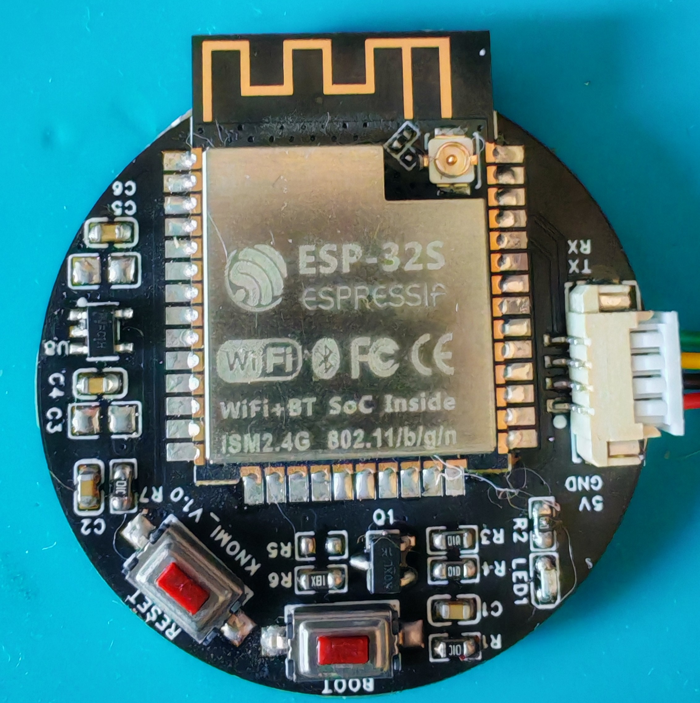

# Solis_Knomi — KNOMI V1 DiverOfDark 固件移植

基于 [DiverOfDark/KNOMI](https://github.com/DiverOfDark/KNOMI) 分支，适配 **4MB Flash / 无 PSRAM** 的 ESP32-D0WDQ6-V3 硬件。

当前发行版：[v1.1.0 — WebUI 单管理员认证](https://github.com/Solismuchengxue/Solis_Knomi/releases/tag/v1.1.0)。更新已有设备只需该 Release 的 `firmware.bin`，不要覆盖文件系统、主题或清空 NVS。

---

## 硬件信息

| 项目 | 详情 |
|---|---|
| 芯片 | ESP32-D0WDQ6-V3（双核，revision 3.1） |
| Flash | **4MB**（⚠️ 无 PSRAM） |
| 屏幕 | GC9A01 240×240 圆形 SPI |
| 模块 | 乐鑫 ESP32-S 1.28" 圆屏 |

### PCB



> 数据手册：[ESP32-D0WDQ6-V3数据手册.pdf](ESP32-D0WDQ6-V3数据手册.pdf)

---

## 引脚（KNOMI V1）

```
GC9A01_MOSI : GPIO23       GC9A01_DC  : GPIO19
GC9A01_SCLK : GPIO18       GC9A01_RST : GPIO4
GC9A01_CS   : GPIO5        LCD_BL     : GPIO2        BOOT : GPIO0
```

---

## 目录结构

```
.
├── README.md
├── pcb_image.jpg                         # PCB 实物图
├── ESP32-D0WDQ6-V3数据手册.pdf
│
├── firmware/DiverOfDark_KNOMI/           # ✅ 当前固件源码
│   ├── platformio.ini                    #   含 knomiv1-4mb 环境
│   ├── boards/esp32r8_4mb.json           #   4MB Flash 板子定义
│   ├── src/hal/pinout_knomi_v1.h         #   V1 引脚定义
│   ├── src/tft_setup.h                   #   TFT_eSPI 驱动配置
│   ├── src/network/KlipperStreaming.h    #   Moonraker WebSocket 通信
│   └── data/                             #   GIF 图片资源
│
├── esptool-windows-amd64/                # esptool v5.3.0
├── esp_flash_download_tool/              # 乐鑫官方烧录工具（GUI）
│   ├── bin/                              #   烧录用固件
│   └── configure/esp32/solis_knomi.conf  #   一键烧录配置
├── release/                              # 发行版打包输出
│   ├── flash_tool_v1_0_1.zip             #   开箱即用烧录包（含双语固件）
└── .gitignore
```

---

## 编译 & 烧录

### 依赖

```powershell
# PlatformIO + espressif32 @ 6.13.0
pio pkg install --platform "espressif32 @ 6.13.0"
pip install intelhex
```

从 GitHub 新取源码时，还需将同版本 Release 的 `generated-assets.zip` 解压到 `firmware/DiverOfDark_KNOMI/`，得到 `src/generated/` 下的 4 个构建输入。它们按上游规则不进入 Git；GitHub 自动生成的源码压缩包不包含这些文件。

### 编译

```powershell
cd firmware/DiverOfDark_KNOMI

# 编译固件
pio run -e knomiv1-4mb

# 构建文件系统镜像（修改 data/ 中 GIF 后需要）
pio run --target buildfs -e knomiv1-4mb
```

### 烧录

设备进入下载模式：**按住 BOOT → 按 RESET → 松开 BOOT**

```powershell
esptool.exe --chip esp32 --port COM3 --baud 460800 write-flash `
  0x1000   .pio\build\knomiv1-4mb\bootloader.bin `
  0x8000   .pio\build\knomiv1-4mb\partitions.bin `
  0x10000  .pio\build\knomiv1-4mb\firmware.bin `
  0x300000 .pio\build\knomiv1-4mb\littlefs.bin
```

> 也可用 GUI 工具烧录，见下方「打包发布」章节。

### OTA 更新（设备已联网）

浏览器打开 KNOMI 的 IP 地址 → **更新** 页面，上传 `firmware.bin`。

> 💡 **v1.0.1** Web 界面支持中英文切换，右上角点击 English / 中文 即可。
> 也可直接上传 `firmware.bin` 从旧版升级。

### WebUI 管理密码

- v1.1.0 首次未设置管理密码时 WebUI 开放。在「设置」页下方设置密码后，所有页面、API、文件访问、OTA 和 WebSocket 握手统一要求浏览器原生 Basic 登录。
- 用户名固定为 `admin`，密码由用户自行设置，没有公开默认密码；登录后可在同一位置修改密码。保存后页面重新加载，请使用新密码登录。
- 校验数据保存在设备内部 NVS，普通重启、固件 OTA 和 Wi-Fi 设置不清除密码，不需要管理凭据文件。
- HTTP Basic 不提供传输加密，仅在可信局域网使用，不要暴露到公网。首次启动或 NVS 被清除后，应尽快重新设密。
- 忘记密码不提供远程绕过或清空入口，需另行安排本地维护。开发、构建与验收说明见 [认证维护说明](docs/http-basic-auth.md)。

---

## 打包发布

### v1.1.0 资产

| 文件 | 用途 |
|---|---|
| `firmware.bin` | 已有指定硬件的固件 OTA；与已部署验收的候选逐字节相同 |
| `SHA256SUMS.txt` | 资产校验值 |
| `build-info.json` | 发布源码提交、环境、构建输入及验证边界；不含设备配置或密码 |
| `generated-assets.zip` | 仅 `src/generated/` 的 4 个源码构建输入，不是可烧录的文件系统镜像 |

完整变更与已知限制见 [v1.1.0 发布说明](docs/releases/v1.1.0.md)。此版本不提供新的全盘/文件系统镜像，不打包本机缓存或设备配置。

历史 [v1.0.1 烧录工具包](https://github.com/Solismuchengxue/Solis_Knomi/releases/tag/v1.0.1)继续保留，不重新打包或覆盖；其中固件不含 v1.1.0 管理密码功能。需要 USB 恢复时先核对硬件和原有偏移，既有设备升级优先使用当前 `firmware.bin` OTA。

本地认证固件构建助手、验证和恢复方法见 [认证维护说明](docs/http-basic-auth.md)。发布前应核对固件 SHA-256、标签提交和所有资产，不将 raw dump、配置或私密材料混入发布包。

---

## Klipper 通信机制

通过 **Moonraker WebSocket**（JSON-RPC 2.0）订阅以下对象：

| 对象 | 字段 | 用途 |
|---|---|---|
| `toolhead` | position, status | 喷头位置/状态 |
| `extruder` | (全部) | 挤出机温度 |
| `heater_bed` | (全部) | 热床温度 |
| `print_stats` | state, filament_used, filename | 打印状态 |
| `virtual_sdcard` | progress, file_position | 打印进度 |
| `display_status` | progress | M73 进度 |
| `idle_timeout` | state | 空闲超时 |
| `gcode_move` | (全部) | Gcode 移动参数 |

使用 Klipper 前需将 `firmware/DiverOfDark_KNOMI/knomi.cfg` 加入 `printer.cfg`：

```ini
[include knomi.cfg]
```

WebUI 管理密码只保护 KNOMI 自身的 HTTP 服务，不是 Moonraker 登录凭据。当前 Moonraker 客户端仍不发送 API Key/JWT；启用 Moonraker 鉴权时，应按部署环境仅信任 KNOMI 已确认保留的固定 IP，不放行整个局域网。

---

## 编译参数

| 指标 | 值 |
|---|---|
| RAM | 15.6%（51KB / 320KB） |
| Flash | 78.9%（1,189,333 / 1,507,328 字节） |
| 平台 | espressif32 @ 6.13.0 |
| 框架 | Arduino 3.20017 |
| 依赖 | ArduinoJson 7.4.3, AnimatedGIF 2.2.0, TFT_eSPI 2.5.43 |

---

## 关键问题：PSRAM

本硬件 **无 PSRAM**，原版 BTT 固件依赖 `ps_malloc` 在无 PSRAM 时返回 NULL，导致 LVGL 崩溃。

DiverOfDark 使用 **TFT_eSPI + AnimatedGIF** 替代 LVGL，无需 PSRAM。本项目的维护与验证范围仅为上述指定的 4 MB 硬件。
